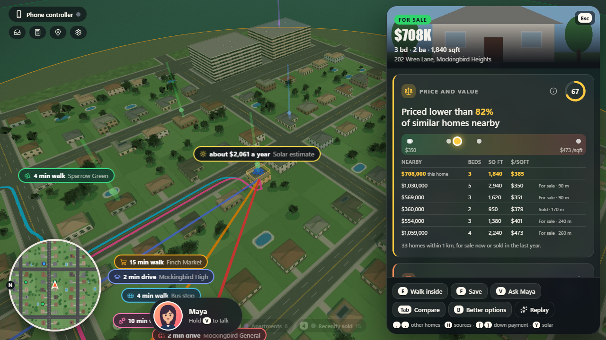
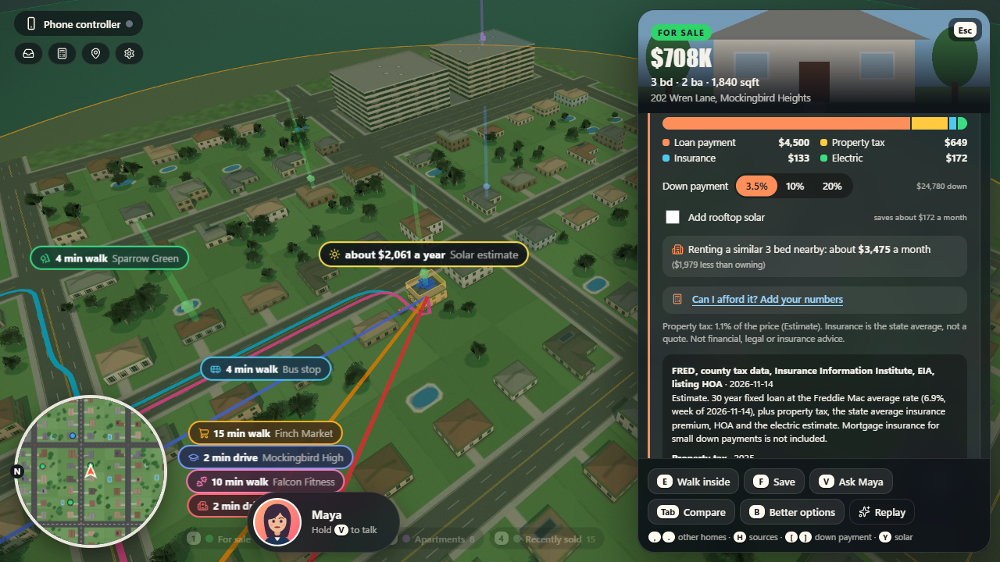
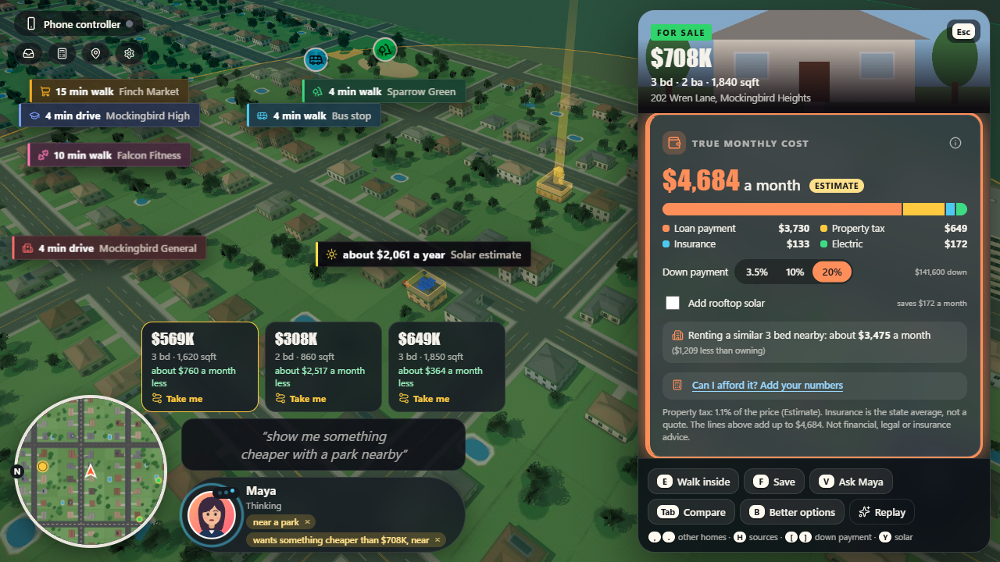
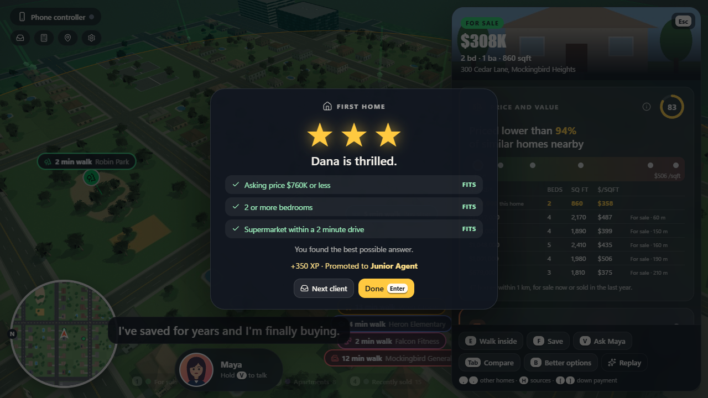
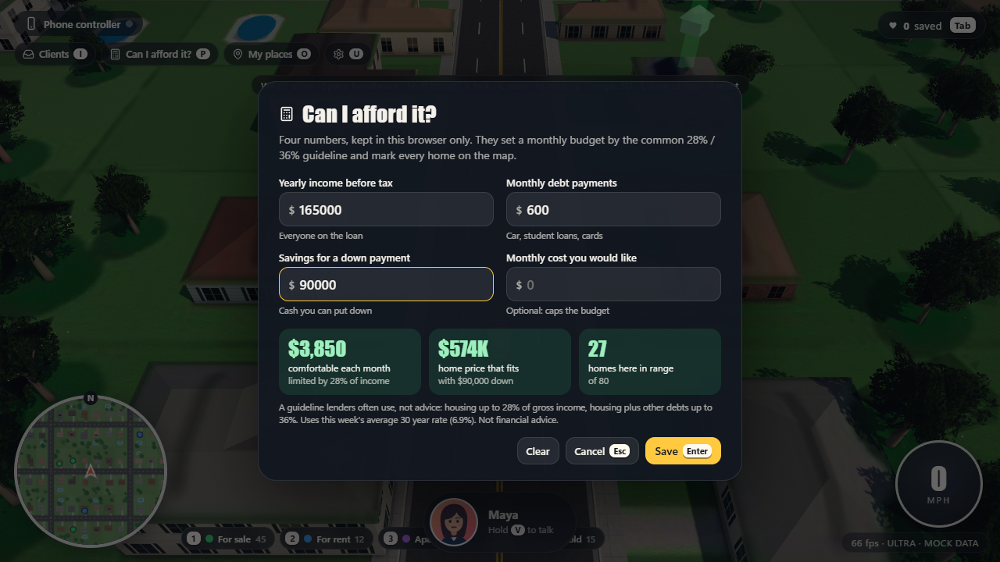
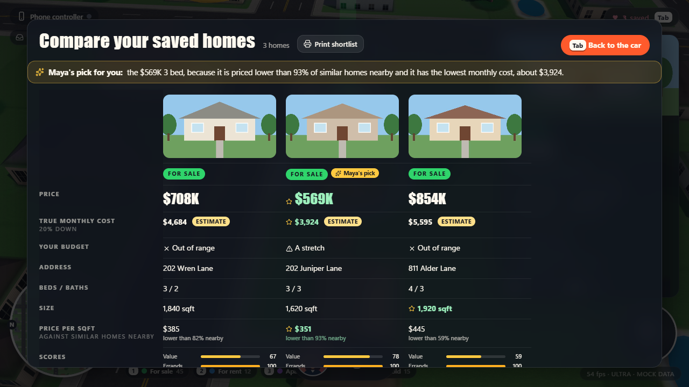

# Insights, Maya and missions: what was built

Run on Sat Nov 14 2026, Prompts 1 to 8 of `INSIGHTS_PLAN.md` in the order 1, 2, 3, 4, 5, 7, 6, 8. Eight commits, one per prompt. The full test suite passes (24 passed, 8 skipped that were already skipped before this run). Screenshots below are from mock mode (synthetic data, safe to share); the same screens on real data are in `shots/` on this laptop only.

## What works

### The property reveal

Click any marker, click a dot on the minimap, or pull up and press `E`. The camera lifts to a drone view, the city dims, the home's outline glows, 5, 10 and 15 minute walk rings spread out, the nearest supermarket, school, park, transit stop, gym and hospital pop up with routes and minutes, solar panels drop onto the roof, a flood zone ripples in blue, and the panel slides in. `Space` skips, the mouse wheel zooms, `Replay` plays it again.



### The insight panel

Eleven cards, each with a plain headline, one small chart, a score ring and an "i" button for source, date and method: price and value (CoStar comps, price history, days on market), true monthly cost (down payment and solar switches, renting nearby), errands and commute, outdoors, energy and solar (with a sun slider), risk and insurance, neighborhood activity, schools nearby, HOA and what's included, area facts, street noise.



### Maya

Hold `V` and talk. She answers out loud with numbers from the local data, flashes the matching card, remembers what you said you want (chips under her name), finds better fits and drives you there. With the model on she is Claude with tools that read only local files; with it off, or when anything fails, she uses scripted lines built from the same tools. Measured: first words about 1.0 to 1.8 seconds after the question; her streamed voice starts about 0.3 seconds after that.



### Client missions

`I` opens the inbox. Eleven buyer and renter situations, each generated from the city's own data so it is solvable: First Home, Room to Grow, Power Bill Hater, Rent or Buy?, Downtown Commuter, Pool Season, Low Risk, Investor, Busy Street Life, Price Detective (guess the price per square foot), Open House Rush (walk 3 homes in 5 minutes). A tracker checks each need against the selected home; the result screen shows stars, what fit, what didn't, and the best possible answer. XP, six levels, eight badges, best runs. Houston shows all 11, LA shows 10.

 

### Buyer tools

- **Can I afford it?** (`P`): income, debts, savings and a target give a monthly budget by the 28% / 36% guideline. Every marker gets a ring: comfortable, a stretch, out of range. 
- **My places** (`O`): pin up to 3 places by name, address or a click on the map. Every home shows the drive; rings can show weekly drive time.
- **Compare** (`Tab`): up to 4 saved homes side by side, a star on the best value in each row, Maya's pick with her reason, and a one page printable shortlist. 
- **Sun and light**: a time of day slider moves the real sun for today at the home's coordinates.
- **Tape measure** (`R` inside a home): click two points on the scan, get feet and inches.
- **Same money, other city**: ask Maya what the same monthly cost gets in Houston or LA, with fast travel.
- **Street noise check**: distance to the nearest highway, rail line and airport, as facts.
- **Price changes** and **what's included** (HOA coverage, apartment amenities) are on the panel.

### Polish

One design system across every screen, spring motion, count up numbers, generated sound (clicks, whooshes, city hum, a music bed), a 20 second tutorial with Maya, settings (`U`), reduced motion, caption sizes, and a keyboard only path through every feature. Demo mode (`0`) runs the whole story by itself.

## Which data each feature uses

| Feature | Source | Notes |
|---|---|---|
| Price per sqft against similar homes, 5 closest comps | CoStar kit: residential listings (for sale now or sold in the last year, same type, within 1 km, widened to 2 or 3.5 km when fewer than four) | Texas sold homes carry asking prices and are labeled so |
| Price changes, days on market | CoStar kit: listing history | |
| Renting a similar home nearby, 3 closest communities | CoStar kit: apartment listing floor plans within 2 km | |
| HOA fee and what it covers, community amenities, parking, heating and cooling, appliances, schools named | CoStar kit: residential listing features | |
| Apartment floor plans, rent ranges, units available, manager, year built | CoStar kit: apartment listings and commercial properties | |
| Neighborhood activity: commercial buildings by type, businesses renting space, largest employers, sales in the last 2 years, buildings finished in the last 5 years | CoStar kit: commercial properties, location occupancy, company detail, sale comps | Tenants by industry is not available: that field is empty in the kit |
| Roof material, shape, condition, existing solar, pool, tree cover, footprint | Vexcel (already cached by the earlier build) | |
| Walk inside, room names and areas, tape measure | Matterport scans | |
| Nearest supermarket, school, park, transit, gym, pharmacy, hospital, cafe, restaurant; shops within a 10 minute walk; highway, rail, airport distances | OpenStreetMap (Overpass), one query per city | |
| Median household income, home value, rent, owner share, year built, for the tract and the city | Census ACS 2024 5-year, tract from the Census geocoder | Read through the Census Reporter API because the Census API now requires a key |
| Natural hazard rating and top 3 hazards | FEMA National Risk Index, by census tract | |
| Flood zone at the home | FEMA National Flood Hazard Layer | Zones A or V add "Flood insurance likely required by lenders" |
| Electricity price | EIA Electric Power Monthly, state residential price, August 2026 (CA 29.75¢, TX 15.91¢ per kWh) | |
| Household electricity use | EIA table 5A, 2024 state averages | |
| Solar output | NREL PVWatts v8, one call per city | |
| Mortgage rate | FRED series MORTGAGE30US (Freddie Mac), 7.11% for the week of Nov 12 2026 | |
| Insurance | Insurance Information Institute table of NAIC data, 2022 state averages (CA $1,492, TX $2,397 a year) | |
| Sun position | SunCalc, from the home's coordinates and today's date | |

Coverage (from `python tools/check_insights.py`): every listing in both cities has places, census, FEMA risk, flood zone, aerial facts, activity and scores. Value and monthly cost exist for every home with a price (22 in Houston, 5 in LA). Solar estimates exist for 20 Houston homes and 1 LA home; the rest are apartment communities or shared roofs.

## What is estimated, and how

Everything in this list is labeled "Estimate" in the game. Formulas are in `docs/SCORES.md`.

- **True monthly cost** = 30 year fixed loan at the FRED rate (20% down by default; 3.5% and 10% on a switch) + property tax + state average insurance + HOA + electric estimate, minus solar savings when switched on. Mortgage insurance for small down payments is not included.
- **Property tax**: Texas homes use the tax figure on the listing itself when it has one, otherwise Harris County's effective rate from ACS (1.62%). Los Angeles uses 1.2% of the price (the 1% Prop 13 levy plus voter approved local rates), because California reassesses on sale.
- **Insurance** is the state average premium, never scaled to the home and never called a quote. "Insurance cost pressure: higher / about average / lower" comes from the FEMA rating and flood zone.
- **Electric bill** = the state's average household use, scaled by floor area against an assumed 1,800 sq ft typical home (limited to half to double), times the state price.
- **Solar** = 60% of the roof footprint seen from the air filled with 400 W panels, output from PVWatts, reduced for tree cover; savings count only power the home would use itself.
- **Drive and walk times** = straight line distance times 1.3, at 25 mph or 3 mph. The rings in the reveal are walk time rings from the same rule.
- **Affordability** = the 28% / 36% guideline, labeled a guideline and not advice.
- **Scores** (errands, commute, outdoors, energy, value, risk, activity) are 0 to 100 from the facts on their own card.

Cost screens say "Not financial, legal or insurance advice". Missing data shows "Not available".

## What is not the real thing

- **Google Solar API and Routes API were not available**: the Google key in `.env` is refused for both (HTTP 403, tried twice). So solar uses PVWatts with the Vexcel roof, panels on the roof are an illustrated layout of the estimated count, and all drive times are distance estimates.
- **No OpenRouteService key**: no true drive time isochrones. The reveal shows walk time rings by distance.
- **Roof condition** is Vexcel's 1 to 5 rating read as 5 = best. The data does not say which end is good.
- **Room fit**: the scans carry room areas, not wall lengths. Maya's sofa answer gives a wall length estimated from the area and sends you to the tape measure.
- **Sun slider** says which side of the home gets light from the sun's direction. It does not claim "backyard" because lot orientation is not in the data. Shadows show on the block city, not on the Google 3D tiles.
- **Barge in** is push to talk: pressing `V` stops Maya mid sentence. An always open mic was not built because speech recognition would hear her own voice.
- **Leaderboard** is the player's own best runs on this laptop.
- **Mock mode** insights are synthetic and say so on the panel.

## Needs attention

1. Add `GOOGLE_SERVER_KEY` (Solar API and Routes API enabled, server side only), then rerun `python tools/enrich_city.py --city houston` and `--city la` for real panel layouts and drive times.
2. Add `ORS_API_KEY` if true drive time rings are wanted.
3. Confirm with Vexcel which end of the roof condition scale is good.
4. Rule 7 in `CLAUDE.md` still says third party sharing is unconfirmed, while `.env` has `LLM_ENABLED=true`. This run followed `.env` and the plan, and kept what each service receives to a minimum: coordinates only to the map, census, FEMA and NREL services; to Claude, the player's words and numbers about homes named h1, h2 (no address, listing id, agent or tenant data). Update the rule text if CoStar's answer is final.
5. Frame rate through the reveal averages 58 to 59 fps with one half second dip to 52 at its start on this laptop (target was 55+). Cold start measured 2.8 to 5.8 seconds on the dev server (target under 6).
6. `tools/check_confidential.py` flags `BUILD_PLAN.md` (an API hostname and a model id). That file predates this run and was not touched.
7. `AGENTS.md` was an untracked file in the folder and went into the first commit of this run. Remove it from git if that was not intended.
8. Insurance averages are 2022, the newest year in the public table.

## Two minute demo, most useful first

Full version with what to say: `DEMO_SCRIPT.md`. Pressing `0` runs all of it by itself.

1. **0:00** The problem: a page of flat listings. "A listing tells you the price, not what it's like to live there."
2. **0:12** Hold `V`: "Find me a three bedroom under 900K near a park." Drive the gold line.
3. **0:30** `E` at the home: the reveal. Walk rings, nearest places with minutes, solar on the roof.
4. **0:45** The panel: price against similar homes nearby, then the true monthly cost next to renting. Switch the down payment, open an "i".
5. **1:05** Hold `V`: "Is this a good deal, and is there a better fit for the money?" Then "Yes, take me there."
6. **1:25** `E` twice to walk inside, `R` to measure a wall.
7. **1:40** `I`: accept Rent or Buy?, select the home with all green checks, submit. Three stars.
8. **1:52** `Tab`: compare, Maya's pick, the printable shortlist.

## How to check it yourself

```
npm run build                         build, and check no server key is in the bundle
npm test                              the whole suite (about 3 minutes)
npm run shot                          screenshots into shots/
python tools/check_insights.py        coverage and outliers per city
python tools/check_fair_housing.py    banned wording check
node tools/maya_fairness.mjs          12 tricky questions to Maya (server must be running)
```

Other records: `PROGRESS_INSIGHTS.md` (every step, done or partly done and why), `DECISIONS.md` (every call made without asking), `docs/SCORES.md`, `docs/PERF.md`, `docs/maya_fairness_check.md`, `LICENSES.md`.
