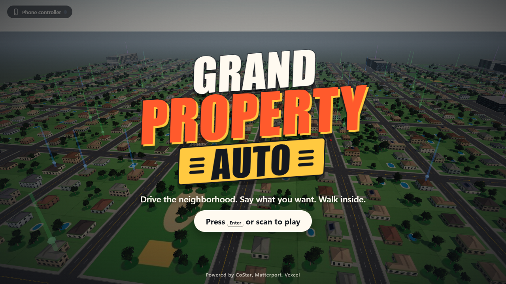
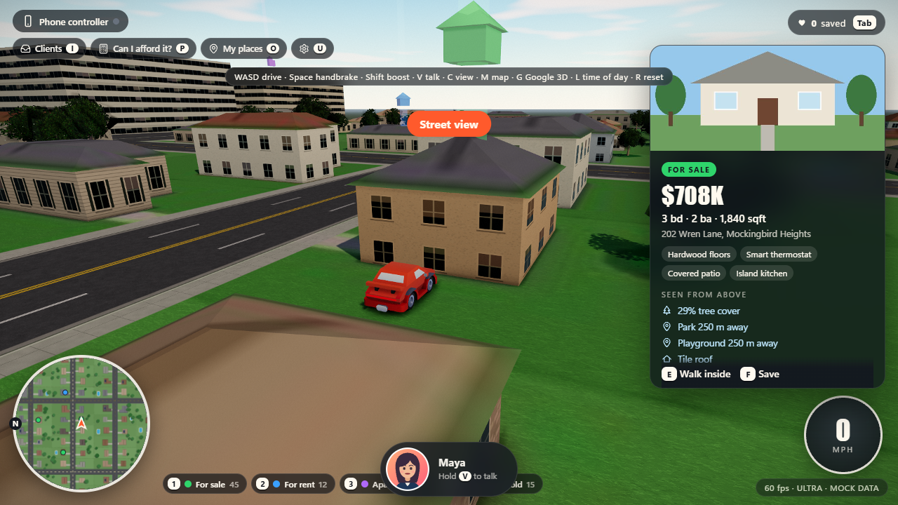
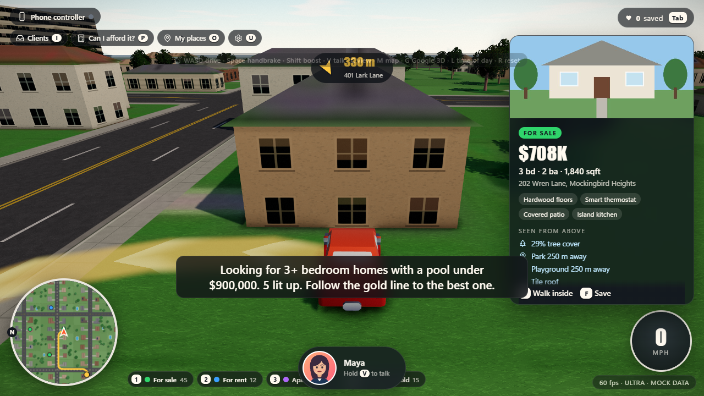
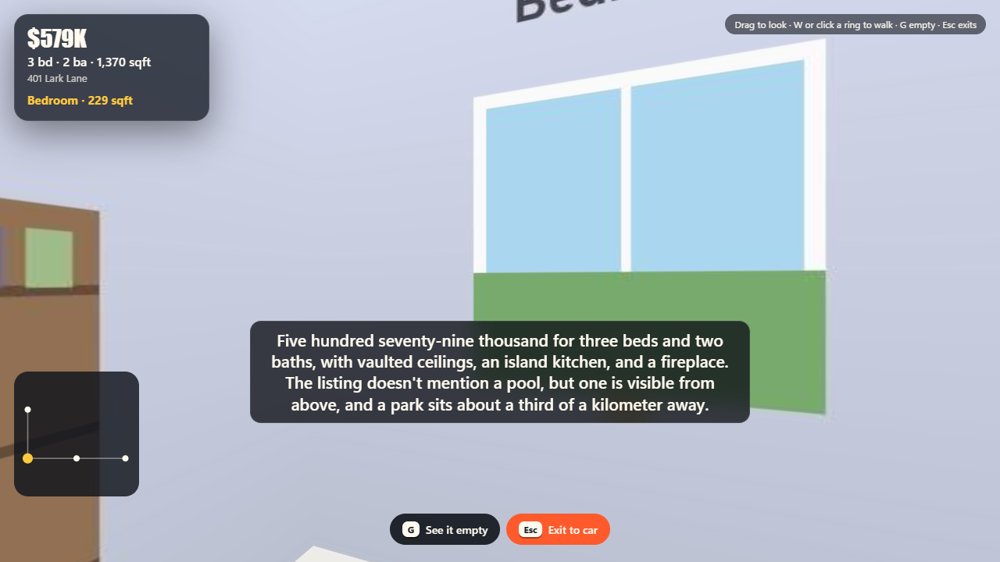

# Grand Property Auto

A driving game for home buyers. You drive a real neighborhood built from aerial data, pull up to homes that are for sale or for rent, and walk inside the real 3D scan. It is free roam by default. Hold a key and say what you want ("three beds under $900k with a pool") and the matching homes light up, a gold line appears on the road, and the game talks you there.

Built at HackPrinceton Fall 2026 for the CoStar track, "Inside and Out: AI for the Built World". The idea behind it: AI as an input, not a chat window. There is no search form and no chat box anywhere in the game.



| Pull up to a home | Say what you want | Walk inside |
|---|---|---|
|  |  |  |

All images here come from mock mode: a synthetic neighborhood with invented homes. See "Data handling" below.

## What you can do

- **Drive.** WASD or arrows, Space for the handbrake, Shift to boost, C for a top down view, R to get back on the road. A gamepad works too.
- **Pull up to a home.** A card slides in with the price, beds and baths, the listing's highlights, and facts read from the aerial view: a pool, solar panels, tree cover, a park nearby.
- **Walk inside** with E. On your own laptop this opens the real Matterport tour. "See it empty" swaps to the same room with the furniture removed, where that exists.
- **Talk to it.** Hold V and speak. Follow up the way you would with a person: "something cheaper", "a bigger yard", "closer to a park", "more like this one".
- **Use your phone as the wheel.** Scan the QR code. Tilt to steer, hold the mic to talk, save homes from your pocket.
- **Compare** your saved homes side by side with Tab.
- **Demo mode** with 0: the game plays itself (mission, drive, arrive, tour, rate, next mission).

## Insights, Maya and missions

Select a home (click its marker, or pull up and press `E`) and the world shows what living there is like:

- **The reveal.** The camera lifts, 5, 10 and 15 minute walk rings spread out, the nearest supermarket, school, park, transit stop, gym and hospital pop up with routes and minutes, solar panels drop onto the roof, a flood zone ripples in blue.
- **The panel.** Price against similar homes nearby (CoStar comps), the true monthly cost (loan, tax, insurance, HOA, electric) with a down payment switch and a solar switch, renting a similar home nearby, errands and commute, outdoors, energy and solar, risk and insurance, neighborhood activity, schools, HOA and amenities, area facts, street noise. Every card has an "i" with its source, date and method. Calculated numbers say Estimate.
- **Maya** (hold `V`). A voice agent that answers from the local data only, suggests better fits and drives you there. She follows fair housing rules and falls back to scripted lines when the model is off.
- **Client missions** (`I`). Eleven buyer and renter situations generated from the city's own data, with stars, XP and badges.
- **Buyer tools.** "Can I afford it?" (`P`), my places with drive times (`O`), compare with Maya's pick and a printable shortlist (`Tab`), a sun slider, a tape measure inside homes (`R`), same money in the other city.

Build the insight data (cached, safe to rerun): `python tools/enrich_city.py --city houston`, then `--city la`. Check it: `python tools/check_insights.py`. Sources and what is estimated: `INSIGHTS_REPORT.md`. Score formulas: `docs/SCORES.md`.

## The three data sources

| Source | What the game uses it for |
|---|---|
| **Vexcel** aerial data | The city itself: the ground image, building outlines and heights, pools, trees and roofs seen from above, angled aerial photos of each home, and a visual search that finds parks, schools and "more places that look like this one". |
| **CoStar** listing data | The homes and apartment communities: prices, rents, beds and baths, features, floor plans and photos, plus quick facts for nearby commercial buildings. |
| **Matterport** 3D scans | The interiors: the walk inside tour, room names and sizes, and the furniture free view. |

The fun part is where they meet. The listing card says what the agent wrote; the badges under it say what the aircraft saw. When they disagree ("the listing does not mention a pool, but there is one in the backyard") the game says so.

## Run it

You need Node 20 or newer and, for rebuilding data, Python 3.11.

```bash
npm install
```

```bash
npx playwright install chromium
```

Copy `.env.example` to `.env` and fill in the keys you have. With no keys at all the game still runs on the mock neighborhood.

```bash
npm run dev
```

Then open http://localhost:5173. For the one command production run:

```bash
npm run demo
```

That builds the game and serves it at http://localhost:8787.

Useful switches:

- `GAME_MODE=mock` in `.env` (or `?mode=mock` in the address bar) loads only the synthetic neighborhood. Use this for anything public.
- `LLM_ENABLED=true` lets Claude parse what you say and write the arrival narration. With it off, a local keyword parser and narration templates do the same job with no network.
- `?autostart=1` skips the title screen. `?q=low` forces low graphics.

Tests and screenshots:

```bash
npm test
```

```bash
npm run shot
```

## Rebuild the data

The city files are built once from the sponsor data and cached; the game never calls the aerial API while you drive.

```bash
python tools/pick_area.py
```

```bash
python tools/build_city.py --city houston
```

```bash
python tools/check_data.py houston la mock
```

The mock neighborhood is rebuilt with:

```bash
python tools/make_mock_data.py
```

## Data handling

The sponsor data came with an agreement, and the project is set up around it:

- **It stays on this laptop.** No cloud hosting, no tunnels, no data in git. The phone controller talks to the laptop over the same wifi or the laptop's hotspot.
- **It is only used during the event window.** Every call to a sponsor API goes through a guard that refuses to run outside it.
- **Public material is mock only.** Screenshots, video and this README use the synthetic neighborhood, which contains no sponsor data.
- **It is deleted after the event.** `bash tools/purge.sh` removes the raw data, caches, processed city files, screenshots and the local scripts that carry sponsor schema details, then lists what is left to clear by hand.
- **Only permissive open source** (MIT, BSD, Apache 2.0, ISC). See `LICENSES.md`.

## How it is put together

```
src/        the game, one module per system: world, car, camera, listings, hud, minimap,
            tour, missions, voice, controller, audio, title, compare, demo
server/     a small Node server: mission parsing, narration, the phone relay
tools/      Python scripts that build the city files, and the mock data generator
public/data/mock/   the synthetic neighborhood (the only data in git)
tests/      Playwright smoke tests and the screenshot run
```

The art is original. This project is not affiliated with any other game.
